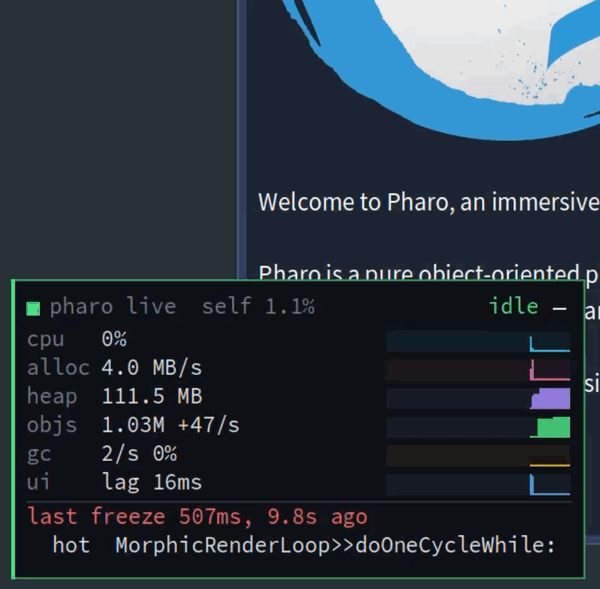

# Pharo Live Monitor

A tiny always-on activity monitor for your Pharo image. It **keeps updating even when the UI thread is frozen**, and tells you which method is looping and which classes are being created in bulk.

<p align="center">
  
</p>

## Install

```smalltalk
Metacello new
	baseline: 'LiveMonitor';
	repository: 'github://FedeLoch/pharo-live-monitor:main/src';
	load.
```

That's it: the panel appears in the bottom-left corner and stays on, including after image restarts.

## Use

- **–** minimizes it to a tiny status tab; click the tab to bring it back. If the UI freezes, the full panel pops up on its own.
- Drag it anywhere. Right-click for *object census*, *back to the corner* and *stop*.
- Try it: `LMExamples allocationStorm` (freezes the UI for 8s), or `LMExamples longExperiment` to see the progress of a long run.
- `LiveMonitor stop` / `LiveMonitor start`, or *Debug ▸ Profiling ▸ Toggle Live Monitor*.

## Reading the panel

**Header.** The dot and the word on the right give the overall status:

| Status | Meaning |
|---|---|
| `idle` | CPU below 5% |
| `ok` | normal activity |
| `BUSY` | CPU above 90% |
| `ALLOC STORM` | more than 200 MB/s of new objects: something is creating garbage in a loop |
| `FROZEN` | the UI process hasn't answered for more than 400 ms |

`self x%` is the monitor's own CPU cost, averaged over the last 10 seconds.

**Metrics.** Values are measured over 0.5 s windows. Each sparkline shows the last ~48 s, one bar per window, newest on the right.

| Row | What it measures |
|---|---|
| `cpu` | Share of time the image is running Smalltalk code rather than idling. The monitor checks every 20 ms which process is running. |
| `alloc` | Bytes of new objects allocated per second, from the VM's allocation counter, excluding the monitor's own allocations. |
| `heap` | Memory in use: heap size minus free old space. Includes garbage the GC hasn't collected yet. |
| `objs` | Number of objects in the heap, and its net change per second. Counted by walking the heap every few seconds (more rarely on big images, to stay around 1% cost). |
| `gc` | Young-generation GCs (scavenges) per second and the share of time spent in GC. `FULL` appears when a full GC happened in the window. |
| `ui` | `lag`: how late the UI process answers, beyond its normal 50 ms beat. `FROZEN Ns`: how long it has not answered at all. |

| `prog` | How far the busy (or frozen UI) process is in its loops, and the estimated time left. See *Progress* below. |

`cpu` bars go from 0 to 100%. `alloc`, `gc` and `ui` bars are scaled from zero to the highest value shown. `heap` and `objs` bars are scaled from their lowest to highest value, so that small changes stay visible.

**Details.** Extra lines appear below the metrics when there is something to explain:

- **`UI frozen for Ns`**, then **`last freeze Ns, Xs ago`** for 20 s after the UI is back.
  - `loop`: the innermost method found on the UI stack in at least 80% of samples. This is where it's spinning, or the call that never returns.
  - `hot`: the method most often at the very top of the stack, where the CPU time actually goes.
  - `| …`: the top of the UI stack at the latest sample.
- **`busy <process> N%`**: when the CPU is above 30% but the UI is responsive, this names the process doing the work, with its own `loop` and `hot` lines.
- **`new instances (census)`**: the classes whose instance count grew the most between the last two object censuses, for example `+43.0K OrderedCollection`. A census runs automatically when the UI has been frozen for 1.5 s or during an allocation storm, and on demand from the right-click menu.
- **`whole image blocked Ns`**: the monitor itself couldn't run for more than a second. Only code at priority 80 (`valueUnpreemptively`), a long primitive, an FFI call or a long GC can do that.

## Progress

Run your experiment as usual, from a Playground or in a forked process: no progress bar to add, nothing to configure. When a process is busy or the UI is frozen, the panel reads the loops on its stack and shows:

```
prog   43%  eta 2m10s       ██████████░░░░░░░░░░
            9/20  epoch in DoIt
         233/500  sample in DoIt
         184/1000  step in MyModel>>train:
```

- **Which loops.** Loops around your code that never move (like Morphic dispatching the event that started your doit) are ignored: progress starts at the outermost loop seen moving, and is refined by the loops inside it, like an odometer. A loop running in a collection iterator is named after your block (`epoch in DoIt` rather than `index in Interval>>do:`).
- **Time left** is the average speed so far, extrapolated. It appears after 2 s of watching, and assumes iterations take about the same time.
- **Not covered:** recursion, loops with no known bound (`[converged] whileFalse: [...]`) and file streams show no percentage. Hashed collections (`Set`, `Dictionary`) progress over the slots of their table, which is close to their elements.

### How progress works

1. **Which process.** Every 0.5 s window, the sampler picks the process to read: the UI process when it is frozen, otherwise the process it caught running most often during the window. When nothing is busy, there is no progress.
2. **Finding the loops in a frame.** Every `do:`, `collect:`, `select:`, `withIndexDo:`, `inject:into:`... of the collections, and every `to:do:` you write, is compiled to an inlined loop: its counter is a plain temp of the stack frame, and when the bound is not a constant the compiler keeps it in a hidden temp too (`0limit_<counter>`). For each frame, the monitor maps the frame's pc to the node of the method being executed, walks up to the loops around it, and finds in the compiler's IR which temp holds the counter and which holds the bound (inside a temp vector when a closure captures the counter). It also knows inlined `timesRepeat:` (hidden `01iterator` / `01limit` temps), counter loops like `Interval>>do:` or `[i <= n] whileTrue: [... i := i + 1]`, and `[stream atEnd] whileFalse: [...]` on in-memory streams. This analysis is done once per method and pc, then cached.
3. **Reading them.** Each loop is then just a few frame slots to read: the counter, the bound, the start. That is how the debugger reads variables, without running anything.
4. **Which loops count.** Each loop is identified by where it is in the code and how deep its frame is from the bottom of the stack, so a loop that starts again for the next outer iteration is the same wheel wrapping around. The outermost wheel seen moving is the outer loop of the work. Wheels further out never moved: they belong to whoever started the work.
5. **Combining them.** From the outer loop inwards, like an odometer: `progress = (done₁ + (done₂ + (done₃ + …) / total₃) / total₂) / total₁`. A 10-iteration outer loop still advances smoothly because the loops inside it fill the gaps.
6. **Time left.** `(1 − progress) × elapsed / progress gained`, since the outer loop was first seen. When the outer loop goes back (a new run started), it counts from there.

It is safe to do from the sampler, which interrupts arbitrary code at a high priority: it only reads frame slots and instance variables and never sends a message to your objects, and it parses methods into its own trees instead of the image's shared AST caches, which the interrupted process might be updating. At most 10 methods never seen before are analyzed per window; the others wait for the next one.

## Overhead

About **1–2%** of CPU while idle. The panel shows its own live cost as `self x%`. While the UI is frozen it does extra work (stack sampling, and an object census budgeted at about 3%), which is when you need it.

On/off benchmarks: Pharo 14, Apple M3 Pro, headless. Each workload runs about 1 s with the sampler paused (off) and running (on), alternating, 15 times; the table shows the medians. The monitor stays running between runs, as in real use, so its first heap count and census are not included. *Without progress* is the monitor before this feature, *with progress* is this version.

| Workload | Without progress (off → on) | With progress (off → on) | Progress itself: first look / then every 0.5 s |
|---|---|---|---|
| Nested loops, CPU-bound (`20 factorial`) | 924 → 934 ms (+1.1%) | 902 → 913 ms (+1.2%) | 9.5 ms / 0.12 ms |
| Allocation-heavy (100K `Point`s, 250 times) | 384 → 394 ms (+2.6%) | 384 → 401 ms (+4.4%) | 1.2 ms / 0.07 ms |
| Deep stack (2,000 frames) | 866 → 874 ms (+0.9%) | 998 → 1000 ms (+0.2%) | 2.5 ms / 1.7 ms |
| Many methods (two test suites, 27 times) | 899 → 960 ms (+6.8%) | 1007 → 993 ms (−1.4%) | 7.7 ms / ~0 |
| Idle, 10 s (`self` cost) | 1.2% | 1.0% | — |

- The differences stay inside run-to-run noise: the same deep-stack benchmark repeated gave +10.4% and +2.8% without progress, +1.2% and +2.8% with it.
- Progress itself costs a few ms the first time new methods show up on the busy stack, then well under 0.1% of the time, except on very deep stacks where walking 2,000 frames takes about 1.7 ms per window (0.3%).
